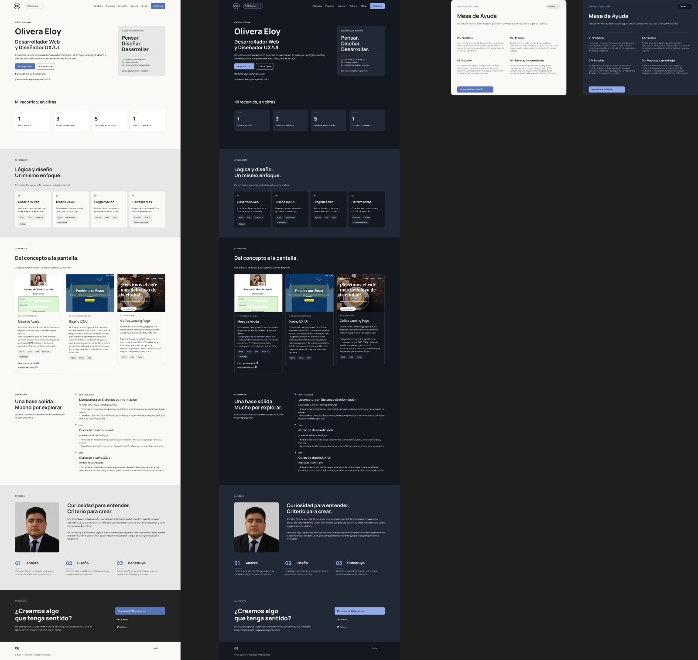
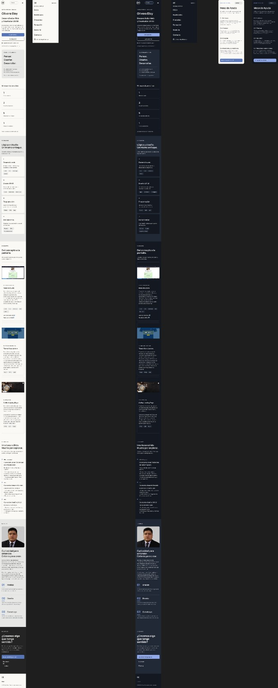
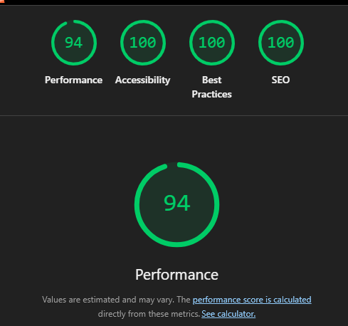

# Portfolio personal — Eloy Olivera

Portfolio web personal desarrollado como trabajo final de **Diseño UX/UI (2026)** de la Licenciatura en Sistemas de Información. Presenta mi perfil, habilidades, formación y proyectos de desarrollo web y diseño UX/UI mediante una página responsive.

## Enlaces

- **Sitio publicado:** https://eloyolivera-ux.github.io/portfolio-personal/
- **Repositorio:** https://github.com/eloyolivera-ux/portfolio-personal
- **Diseño y prototipo en Figma:** https://www.figma.com/design/yVRGTlEWng9uQ8KW7bYrcI/Portfolio-Personal---UX-UI
- **GitHub:** https://github.com/eloyolivera-ux
- **LinkedIn:** https://www.linkedin.com/in/eloy-olivera-b178a144a/
- **Contacto:** eloyolivera119@gmail.com

## Tecnologías utilizadas

- **HTML5:** estructura semántica del sitio.
- **CSS3:** estilos, diseño responsive, Grid, Flexbox y variables CSS.
- **JavaScript vanilla:** menú móvil, cambio entre tema claro y oscuro y apertura del caso de estudio.
- **Figma:** investigación visual, wireframes, design system y prototipos.

El sitio es estático y no utiliza frameworks de JavaScript ni constructores visuales.

## Contenido del portfolio

El sitio reúne una presentación personal, indicadores, habilidades, proyectos, formación, información sobre mí y datos de contacto. Incluye navegación por secciones y un caso de estudio del proyecto Mesa de Ayuda.

## Proyectos destacados

| Proyecto | Repositorio |
| --- | --- |
| Mesa de Ayuda | [Ver proyecto](https://github.com/eloyolivera-ux/mesa-de-ayuda) |
| Tienda Boca Juniors | [Ver proyecto](https://github.com/eloyolivera-ux/Diseno-UX-UI/tree/main/Tp-3/ejercicio20) |
| Coffea Landing Page | [Ver proyecto](https://github.com/eloyolivera-ux/coffea-landing) |

## Diseño y funcionamiento

Diseño adaptable a pantallas de escritorio, tablet y móvil, con navegación por anclas, menú móvil, modo claro/oscuro y caso de estudio interactivo. Se incorporaron elementos de accesibilidad como enlace para saltar al contenido, estados de foco visibles, etiquetas accesibles y preferencias de movimiento reducido.

## Capturas del sitio

### Versión Desktop

### Versión Mobile

## Lighthouse Mobile

Resultados obtenidos en Google Chrome, modo Mobile:

| Performance | Accessibility | Best Practices | SEO |
| ---: | ---: | ---: | ---: |
| **94** | **100** | **100** | **100** |

## Recursos y créditos

- **Diseño visual:** desarrollado a partir de mi propio prototipo en [Figma](https://www.figma.com/design/yVRGTlEWng9uQ8KW7bYrcI/Portfolio-Personal---UX-UI). No se utilizó una plantilla de terceros como base del sitio.
- **Tipografía:** [Manrope](https://fonts.google.com/specimen/Manrope), disponible en Google Fonts.
- **Fotografía personal e imágenes:** archivos incluidos en `assets/img/`.
- **Referencias visuales del proceso UX/UI:** [Cathrine Understrup](https://cathrine.co/), [Brittany Chiang](https://brittanychiang.com/) y [Anurag Hazra](https://anuraghazra.dev/).

## Ejecución local

Clonar o descargar el repositorio y abrir `index.html` en el navegador. No requiere instalaciones ni compilación.
